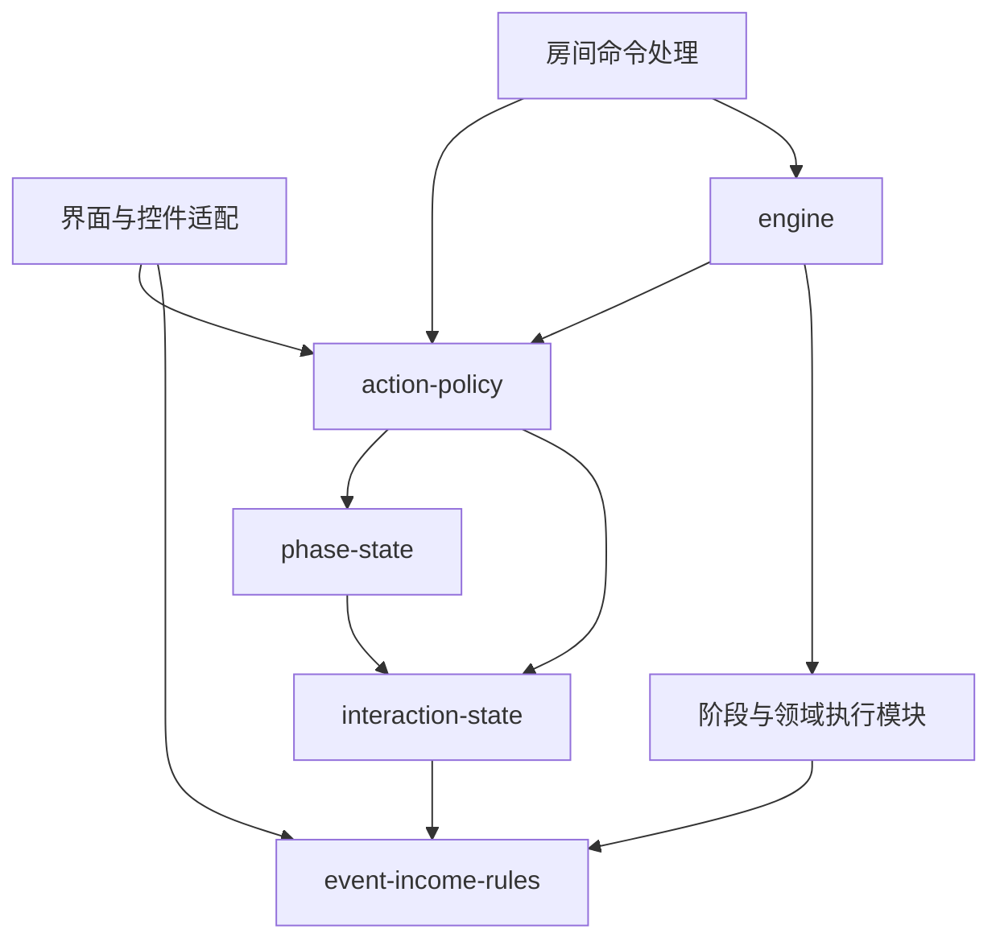

# 当前架构与源码导航

Steam 最新实现、启动和验证边界见 [Steam 四人客户端](steam-networking-2026-09-17.md)。

更新于2026-09-17。项目使用原生浏览器 ES modules 与 Worker 房间服务，保留现有游戏状态、六轮流程和本地 SQLite 开发入口。共享待办权限与责任人，持续收益分离规则与执行，事件按机制分发。基础边界见[架构重构记录](architecture-refactor-2026-09-17.md)，最新覆盖见[WIT集中交付](wit-complete-2026-09-17.md)。

这份文档描述当前设计，历史机制验收保留在各批记录中。WIT覆盖58张非转折事件、2张转折点、14项持续效果；事件国家包含乌克兰2014替换、英国新增及额外朝鲜2024。本批5类主动整牌预检缺口已修复，有限候选与实际验证见[整牌预检完成记录](sequence-complete-2026-09-17.md)。目标已按用户裁定以当前净提升计分，保留明确要求曾经达成的事件历史及旧存档投资回报核对。

## 一次房间操作

1. 浏览器将选择转为动作命令。`control-command.js` 为控件提供动作类型，`action-policy.js` 判断当前席位能否发起该类动作；表单继续检查费用和目标。
2. `server/index.js` 验证请求身份，`server/rooms.js` 验证席位、命令版本与重复请求，通过共享房间权限策略后，在完整服务端状态上调用 `applyAction`。
3. `engine.js` 检查游戏待办与阶段限制，克隆状态，再交给事件、阶段和卡牌领域模块。领域模块校验完整参数、费用、目标、次数和牌面条件；失败不保存克隆结果。
4. `server/room-db.js` 按房间 `revision` 条件更新数据库。成功后只返回请求席位的脱敏视图；客户端不能以自己的视图覆盖完整状态。

本地热座直接调用同一 `applyAction`，独立保存至浏览器。房间身份、席位固定和数据库并发属于服务端职责，不能依靠界面禁用按钮替代。

## 只读基础层与执行层

下图展示主要依赖方向，箭头表示“使用”，不是完整导入图。

| 模块 | 职责与边界 |
| --- | --- |
| `dist/game-constants.js` | 势力、地区和资源名称，读取常量不需要加载游戏执行器 |
| `dist/interaction-state.js` | 从已有待办读取交互种类、责任人、原所属玩家、展示方式和可发起动作集合 |
| `dist/phase-state.js` | 六轮阶段、余波步骤、逐方结算进度；优先使用当前交互责任人 |
| `dist/action-policy.js` | 游戏／房间动作类型准入、开局与手动窗口、已确认席位锁定；返回拒绝原因，不执行效果 |
| `dist/event-income-rules.js` | 持续收益的只读规则、选项、不可用原因和执行计划；接入中东欧、中伊与美欧各自的TTIP投资面收益 |
| `dist/event-decision-rules.js` | 七张同型个人决策的零依赖配置：费用、减费条件、奖励、产能、影响力、投资与连锁 |
| `dist/control-command.js` | DOM控件到动作类型的适配；新控件可声明 `data-command`，不在此判断规则 |
| `dist/room-rules.js` | 原房间接口的兼容入口，转用共享策略，保留 `roomActor`、`assertRoomAction` 等调用方式 |

共享策略只回答“这个席位此时能否发起这类动作”。它不是完整命令schema，不取代研究费用、投资对象、牌面支出或秘密信息等领域校验。界面保留领域条件原有的禁用结果。

`scripts/check-architecture.mjs` 限定六个只读基础模块只能依赖这个基础层，禁止导入执行器、UI、I/O或外部包。它也检查 `dist/` 根目录手写 `.js` 模块的相对静态导入及可识别的字面量动态导入图无循环。当前检查通过；这不代表整个项目或任意运行时动态依赖均已证明无环。

## 待办与责任人

交互按以下顺序选择当前显示内容和责任人：事件分发／事件结算、持续收益、发展选择、追加结盟、卡牌序列。没有交互时，才按逐方结算或普通阶段顺序确定责任人。

多个待办可以同时存在。例如原卡进入追加结盟后，玩家再使用抽换牌发展，会同时保存 `cardResolution`、`pendingRelation`、`pendingGrowth`。界面显示最内层的发展选择；准入检查同时遵守尚未完成的限制，完成后恢复追加结盟，再回到原卡。事件命令维持已有的优先分发边界。

`actor` 是当前需要操作的玩家，`owner` 是交互所属玩家，两者可不同。中国的持续收益可以暂交欧盟回应，资产序列也可以等待俄罗斯；不能只按行动顺序或 `state.current` 判断房间权限。脱敏视图中 `current` 表示本标签页席位。

手动窗口保留已有范围：未确认的非责任席位只能执行 `MANUAL_ACTIONS` 中的8种本方补记动作。它不会取得地图移除／军队调整权限。房间始终禁止 `switch`，手动 `region` 不能修改他方驻军。自动待办结束前，不允许用手动调资源或提前推进阶段绕过它。

## 持续收益：先规划，再执行

`event-income-rules.js` 的 `INCOME_RULES` 定义初始选择、回应状态、责任人、可用原因和计划函数。`incomeChoiceModel` 生成可序列化的公开选项，界面与服务端使用同一来源。`incomeChoicePlan` 校验本次选择，返回资金、资源、翻用贸易卡等操作及下一待办状态。

`event-income.js` 应用这些操作，正向资源发放复用 `gainResource` 处理库存上限和折现，然后保存公开数值变化与文字账目。计划由服务端根据当前状态生成，不接受客户端提交任意操作列表。未知效果、未知回应或过期轮次会拒绝，不套用到已实现规则。

投资回报仍由 `flow.js` 控制：先发基础FDI和撤回介入收入，生成 `pendingIncome`；全部持续收益完成后才登记本方完成并推进。新取得效果统一记录在 `eventEffects`，全局效果兼容既有 `activeEffects` 字段；效果目录本身不表示玩家已取得该效果。

中东欧、中伊和TTIP投资面使用上述规划／执行结构。效果目录、取得状态、主动效果分别由 `event-effect-rules.js`、`event-effect-state.js`、`event-effect-actions.js` 管理。两条管道与TTIP资源交换面按用户裁定在本方任意阶段每轮各用一次；执行器验证所属、次数、资金、制裁及贸易卡等条件，界面复用其预览。其他主动牌保留原领域实现，没有建立通用牌面解释器。

## 领域模块导航

`event-personal.js` 按事件族登记条件与执行器，`event-personal-ui.js` 按同一分类分发渲染、读取与预览。同型决策继续使用 `event-decision-rules.js` 与 `event-decision.js`；军事决策使用费用、生产、移动、奖励与连锁配置；经济检查复用基础介入和投资。新增同型牌只登记差异，新机制才扩展执行步骤。随机连锁及其他未迁移事件保留专用实现；这些领域模型仍可导入执行器，不属于上述六个纯依赖模块。

共同竞价沿用统一秘密投标、扣费、胜负与军队归位流程，阵营修正和结果操作使用配置。`event-agreements.js` 管理公开承诺、达成条件、统一扣费与奖励队列；`event-special-personal.js` 管理疫情逐方选择、阿富汗撤军交接及特殊国家变化，沿用现有事件动作与责任人。`event-losses.js` 统一强制资金／资源损失及短缺扣分。

`EVENT_EFFECTS.tradeRegions` 描述展示国家贸易范围；制裁、贸易战附加费用、威胁修正从共用效果状态读取，避免各入口重复识别牌号。国家助手统一处理替换、取得、退回和移除，维护盟国与投资标记；朝鲜2024是独立国家实体。`event-reveal.js` 识别秘密揭标和随机国家变化，让房间撤销遵循同一边界。

| 文件／模块组 | 从这里处理的工作 |
| --- | --- |
| `dist/engine.js`、`flow.js` | 新局、动作执行入口、阶段转换、行动计数、准备／研究／余波、终局 |
| `dist/app.js`、`flow-ui.js`、`room-ui.js` | 操作桥接、交互面板分发、本地／房间展示；`index.html`、`style.css`、`rooms.css` 为页面与样式 |
| `dist/phase-settlement.js`、`phase-ui.js`、`settlement-journal.js` | 逐方确认、阶段概览、公共数值账目 |
| `dist/event-board.js`、`event-flow.js`、`event-ui.js` | WIT布置、顺序、连锁／转折点、确认与历史 |
| `dist/event-personal*.js` | 个人事件族分发、生命周期账目和界面入口 |
| `dist/event-bids*.js`、`event-losses.js` | 共同竞价、阵营修正与结果操作；强制损失和短缺扣分 |
| `dist/event-agreements*.js` | 共同协议承诺、费用、奖励队列、TTIP双面及对应表单 |
| `dist/event-special-personal*.js` | 六张特殊事件、逐方结算、撤军、国家变化及旧存档历史确认 |
| `dist/event-effect-rules.js`、`event-effect-state.js` | 14项持续效果目录、取得／移除状态、贸易／威胁钩子与事件国家助手 |
| `dist/event-effect-actions.js`、`event-effects-ui.js` | 管道和TTIP主动交易、TTIP首次选面、次数与费用预览及界面 |
| `dist/event-effects.js`、`event-reveal.js` | 效果兼容导出与贸易地区合并；揭标／随机变化识别 |
| `dist/event-decision-rules.js`、`event-decision.js` | 同型个人决策配置、费用与选项模型、共同执行步骤；正常投资复用基础投资规则 |
| `dist/event-military*.js` | 军事决策的费用、产能、生产、移动、奖励与连锁，以及对应表单 |
| `dist/event-economic-checks*.js` | 经济检查事件及表单；CETA正常介入、CPEC真实多份FDI |
| `dist/event-income*.js` | 持续收益规则、执行、跨席位回应和历史界面 |
| `dist/card-sequence.js`、`sequence-availability.js`、`card-sequence-ui.js` | 多段卡牌、预检、回应、恢复和手动剩余步骤 |
| `dist/growth-battlefield.js`、`growth-battlefield-availability.js` | 战役优势状态与父行动暂停／恢复；完整资产预检单独供序列启动和界面使用 |
| `dist/basic-actions.js`、`country-actions.js`、`military.js` | 基础行动、投资／介入、结盟／升级、基地／派兵／移动 |
| `dist/economy.js`、`trade.js`、`commerce.js`、`research.js` | 产能／繁荣／焦点、贸易容量与费用、贸易卡状态、研究奖励／购牌 |
| `dist/world.js`、`world-ui.js` | 影响力槽位、威胁、地区／多数／国家计分 |
| `dist/growth-*.js`、`smart-power*.js` | 发展主动能力与触发、SP增强 |
| `dist/objective-data.js`、`objectives.js`、`objective-progress.js` | 目标条件、计分与历史提升记录，接入原逐方结算 |
| `dist/market-*.js`、`special-*.js`、`dd-*.js` | 市场能力、战略资产、行政命令与扩展效果 |
| `dist/intelligence*.js`、`opponent-effects.js`、`regime-change.js` | 授权查看／复制、他方回应、夺取国家 |
| `dist/foreign-investments*.js`、`investment-tokens.js` | FDI归属、多个投资及收益 |
| `dist/room-client.js`、`server/rooms.js` | 标签页身份／同步、房间命令、玩家视图、撤销与去重 |
| `server/index.js`、`server/room-db.js` | HTTP API、可信平台身份、D1条件保存 |
| `scripts/dev-local.mjs`、`scripts/development-db.mjs`、`vite.config.js` | 本机HTTP／SQLite开发入口与Vite适配 |
| `scripts/build.mjs`、`db/schema.ts`、`drizzle/` | 生成前端／Worker、数据库结构与迁移 |

## 存档与隐私约定

游戏状态保留 `version: 2`，房间封装保留 `version: 1`；经济、地图、事件等按各自已有版本字段识别。本次不重写存档格式、不改数据库迁移，也不补造旧局历史。热座键 `world-order-table-m2-v2` 与房间数据库相互独立。

| 持久化字段 | 含义 |
| --- | --- |
| `flow.cardResolution` | 卡牌 owner／responder、步骤、位置、上下文与已结算记录 |
| `flow.pendingGrowth`、`flow.pendingRelation` | 发展选牌与追加结盟，可与原卡序列同时存在 |
| `flow.battlefieldReturn` | 被即时资产暂停的原行动、追加出牌和序列 |
| `flow.pendingIncome` | 轮次、收益所属玩家、已领基础收益、剩余效果、回应状态和账目 |
| `flow.eventResolution` | 事件模式、阶段、参与方、已提交者、承诺／投标、奖励队列及特殊事件子阶段 |
| `eventEffects`、`incomeEffectHistory` | 实际取得效果、TTIP选面、主动效果 `usedRound`，以及完成的持续收益记录 |
| `activeEffects`、`eventCountryRandom` | 旧全局效果兼容字段、已执行随机国家操作的变化计数 |
| `flow.settlement`、`settlementHistory`、`settlementJournal` | 逐方确认与公共阶段账目 |
| `players.*.scoredObjectives`、`objectiveHistory`、`finalAwards` | 目标使用／进度和终局奖励 |

`ceeOffer`、`ceeFallback` 等收益状态字符串继续作为存档约定；缺少 `active` 的待办按初始选择读取。新交互必须把进度保存在可序列化状态中，不能只存在DOM或闭包。

服务端隐藏他方手牌、牌库顺序、未确认选牌、目标和盖放牌，保留必要的数量占位。`setupPending` 在隐藏选牌内容时仍保留，避免观察者误判开局结束。情报查看、国家检索仅在授权步骤开放必要内容。共享只读策略须在完整状态和各席脱敏视图上得到相同责任人与权限判断。

## 房间与运行边界

| API | 用途 |
| --- | --- |
| `GET /api/rooms` | 当前账号最近创建的房间 |
| `POST /api/rooms` | 创建房间 |
| `GET /api/rooms/:CODE` | 本标签页可见的房间状态 |
| `POST /api/rooms/:CODE` | `join`／`leave`／`start`／`reset`／`undo`／`action` |

生产读取可信平台注入的 `oai-authenticated-user-id`，再验证 `X-Room-Token`。标签页令牌保存在 `sessionStorage`，不进入分享URL；服务端保存散列。开发固定身份仅用于本机测试。

动作通常携带 `gameRevision`，开局个人选择使用 `seatRevision`，允许四席并行。数据库以 `revision` 比较后交换，最近64条命令去重。`undo` 可携带 `scope: step | phase | turn`，默认 `step`；撤回后版本仍递增。

`rollback-state.js` 由本机桌面和服务端共用：保存最近12步及独立阶段／本方行动起点，30分钟过期；快照不包含历史，服务端只复制当前局面而不重复复制旧快照。抽牌、窥牌、补牌、开局首次资产揭示、秘密投标／随机结果等信息节点及他方提交截断此前窗口。`roomView.rollback` 只含各范围可用性与原因，完整快照留在服务端；客户端同revision轮询也更新到期信息。详见[撤回记录](region-rollback-2026-09-17.md)。这不是完整回放或存档管理系统。

地区点击由 `region-selection.js` 读取真实表单选项，`region-table-ui.js` 激活字段、标记地区／槽位并派发现有change事件。最终费用与目标继续由领域预览和执行器验证，不在板面层复制规则。多次军队移动明确区分第几次的来源和目的地，隐藏或禁用字段不参与选择。

客户端使用轮询和同浏览器 BroadcastChannel 同步；已入座不等于玩家在线。启动、构建及托管说明见[运行文档](RUN_AND_DEPLOY.md)。

## 扩展与验证入口

新增交互应先确定持久化状态、责任席位和父流程恢复位置，再接入 `interaction-state`、领域执行入口、`flow-ui` 渲染分发和控件动作映射。新增投资回报收益优先复用 `INCOME_RULES`，避免分别在界面、责任人判断和执行器中硬编码同一状态。具体步骤见[本批接入说明](architecture-refactor-2026-09-17.md)。

架构检查为 `node scripts/check-architecture.mjs` 与 `node scripts/check-income-rules.mjs`；机制、房间和浏览器实际验证范围见[本批记录](architecture-refactor-2026-09-17.md)及[验证索引](VERIFICATION.md)。新增可保存回应应验证脱敏一致、刷新恢复、失败不变和重复命令不重复领奖。

`dist/` 根目录及 `dist/assets/` 是源码和素材，不能清空。仅 `dist/client/`、`dist/server/`、`dist/.openai/` 为构建生成物。`cards.json` 保存实例ID、图片和TTS来源，不等于全部规则实现；不要用研究编码推测下半部效果，也不要重跑导入覆盖手工校对。生产迁移和用户已有房间必须保留。
